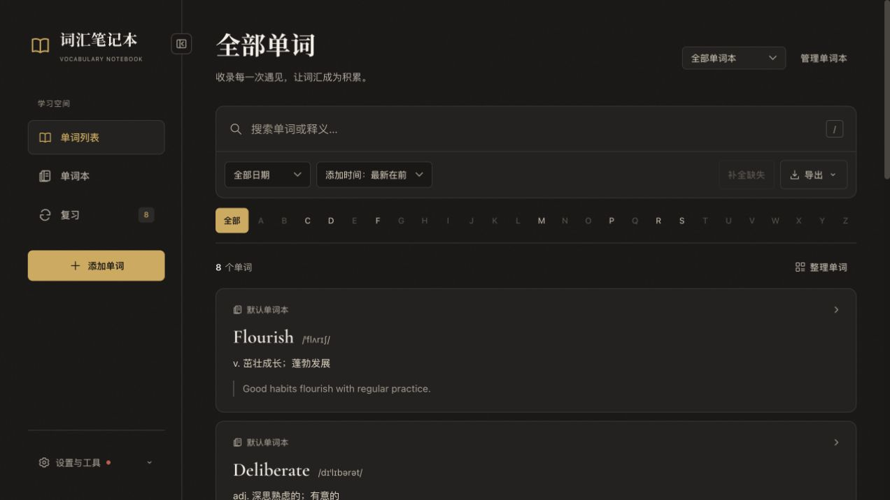
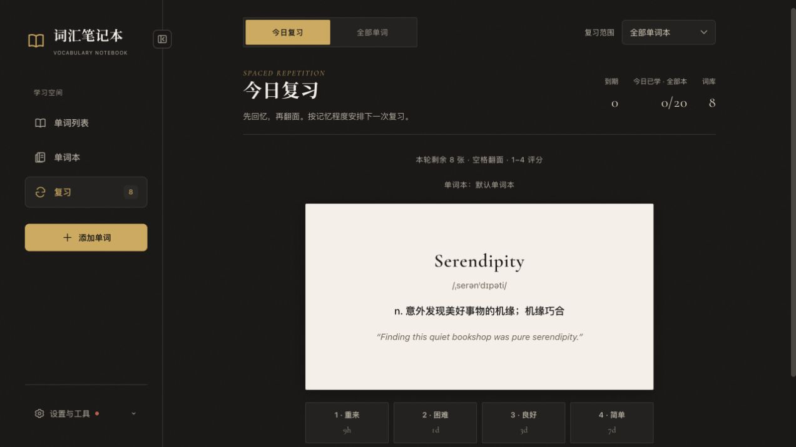

# Vocabulary Notebook

[](https://github.com/Eric-Zhou-0302/vocabulary-notebook/actions/workflows/ci.yml)
[](LICENSE)

一个本地优先的英文词汇笔记本：记录单词，使用 Ollama 或 DeepSeek 补全音标、中文释义与例句，再通过间隔复习巩固记忆。

当前版本：[**1.2.0**](https://github.com/Eric-Zhou-0302/vocabulary-notebook/releases/tag/v1.2.0)。默认分支上的后续改动见 [更新日志](CHANGELOG.md)。

## 功能

- **单词与单词本**：按主题管理词汇；同词可加入多本，每本独立保存内容与复习进度。
- **AI 补全**：支持本地 Ollama 和 DeepSeek API，提供任务进度、失败提示与缺失内容重试。
- **间隔复习**：四档记忆评分、每日新词额度、下次复习间隔预览；也可按字母或随机顺序只读翻卡。
- **查找与导出**：搜索、日期/首字母筛选、添加时间排序，以及 PDF、CSV、JSON 导出。
- **同步与备份**：可选 Google Drive 桌面文件夹或 API 直连；支持完整学习历史备份和合并导入。
- **界面与操作**：深浅色主题、手机布局、桌面可收起侧栏，以及搜索、翻卡和评分快捷键。

应用用于个人电脑本地运行。后端只监听 `127.0.0.1:1400`，不提供公网部署或多用户登录功能。跨电脑学习使用同步功能，详见 [Drive 同步指南](docs/DRIVE_SYNC.md)。

## 界面预览

以下为 v1.2.0 真实界面，使用独立演示词库，不包含个人学习数据。

**单词列表** · 搜索、筛选与词汇整理。



<details>
<summary>查看复习界面</summary>

翻面查看释义与例句，再按记忆程度安排下一次复习。



</details>

## 快速开始

### 环境

- Python **3.11+**；CI 覆盖 3.11 和 3.12。
- 使用已提交的前端构建文件时，不需要 Node.js。
- 修改前端需 Node.js **22.13+（22.x）或 24+** 及 npm。开发与检查使用项目本地依赖。
- 以下命令适用于 macOS / Linux shell。PDF 中文导出需要可用的 Unicode 字体，见下文。

### 安装与运行

```bash
git clone https://github.com/Eric-Zhou-0302/vocabulary-notebook.git
cd vocabulary-notebook
python3.11 -m venv .venv
./.venv/bin/python -m pip install --upgrade pip setuptools
./.venv/bin/python -m pip install -r requirements.txt

# 仅首次创建配置，不覆盖已有设置。
test -f config.json || cp config.json.example config.json
./.venv/bin/python app.py
```

打开 [http://localhost:1400](http://localhost:1400)。`python app.py` 会托管 `frontend/dist`；不需要另外运行前端服务器或启动脚本。

通过「设置与工具 → 模型设置」配置补全服务。没有连接模型时，仍可浏览已有词库和复习。

### 配置模型

**Ollama**：先启动本机或自托管的 Ollama 服务，在模型设置页填写服务地址和实际已安装的模型名称。默认地址为 `http://localhost:11434/api/generate`。

**DeepSeek**：在 [DeepSeek 开放平台](https://platform.deepseek.com/api_keys)创建 API Key，填写后刷新模型列表、选择模型并保存。模型列表由官方接口获取，不在项目中写死。

网页保存配置后立即生效。已有 Key 不会回传浏览器，留空保留原值。若直接修改 `config.json`，需重启后端。配置结构见 [config.json.example](config.json.example)。

可选启用本机词典拼写校验：确认系统已有 Enchant 库及 `en_US` 词典后，运行 `./.venv/bin/python -m pip install -r requirements-spellcheck.txt`。系统要求见 [PyEnchant 安装说明](https://pyenchant.github.io/pyenchant/install.html)。未安装时跳过词典检查，例句中文字符和释义格式检查仍然执行。

### 从旧版本升级

先停止应用，将词库 `words.json`、配置 `config.json` 和凭据目录 `.secrets` 备份到仓库外。低于 Python 3.11 的虚拟环境需用新解释器重建并安装依赖；新环境验证成功前保留旧环境。

首次读取旧词库会保留 `words.json.legacy.bak`，再迁移为支持同步的缓存。不要用旧版程序写入新缓存；迁移与回退说明见 [Drive 同步指南](docs/DRIVE_SYNC.md#旧词库备份与升级)。新版只允许本机访问，跨电脑使用 Drive 同步，不再提供原来的局域网直连方式。

## 日常使用

桌面宽屏使用侧栏导航，默认展开，可收起为图标；窄屏使用顶部导航。「设置与工具」集中提供模型、同步、主题和快捷键设置。

<details>
<summary>展开使用指南：单词本、复习、快捷键与导出</summary>

### 记录与整理

添加页选择单词本、输入单词并保存，补全结果会出现在下方的最近记录中。新词首字母统一大写，其余字符保留；同一本中重复输入会显示已有记录，不重置原有复习进度。

补全期间可继续使用应用。网络、授权或模型响应异常会保留记录供重试；只有明确判定无效且未被用户修改或复习的新空词条，才会自动移除。详情页可手动编辑。

在单词列表中使用「整理单词」：

- **加入单词本**：保留原词，目标本从新词开始复习，跳过已有同词。
- **移动到此本**：保留复习进度；目标本存在同词时停止整批操作，避免覆盖。

同一本内按拼写忽略大小写去重；跨本允许同词。只能删除空单词本，默认单词本始终保留。排序选择保存在当前浏览器中，筛选范围同时用于导出。

### 复习

「今日复习」根据到期记录和每日额度组成队列。先回忆再翻面，按记忆程度评分；选择“重来”的卡片会回到本轮队尾。默认每天引入 20 个新词，各本共用额度，可通过 `config.json` 的 `srs.daily_new_limit` 修改。

「全部单词」按 A–Z 或随机顺序翻阅，不提交评分、不消耗新词额度。该模式只显示当前范围内有释义的词条，单次最多读取 10,000 条。

| 快捷键 | 操作 |
| --- | --- |
| `/` | 聚焦单词列表搜索框 |
| `?` | 打开快捷键帮助 |
| `Space` / `Enter` | 翻开当前复习卡片 |
| `1` / `2` / `3` / `4` | 重来 / 困难 / 良好 / 简单 |
| `←` / `→` | 全部单词模式：上一张 / 翻面后下一张 |

在输入框、下拉框、链接或可编辑区域操作时，复习快捷键不会抢占其键盘事件。

### 导出与完整备份

| 入口 | 内容与用途 |
| --- | --- |
| 单词列表 → PDF / CSV / JSON | 当前筛选下的词汇内容，适合打印、表格整理与二次处理 |
| 同步与备份 → 下载完整备份 | 所有单词本、字段操作、删除标记及评分事件，适合迁移与恢复 |
| 同步与备份 → 导入备份 | 合并导入完整备份或旧词库，不覆盖整个现有词库 |

**普通列表导出不能替代完整学习历史备份。**

PDF 使用 `fpdf2` 直接生成，不依赖 HTML 模板。macOS 默认尝试系统 Arial Unicode 字体；其他环境可指定覆盖所需中文、音标的静态 TTF / OTF 字体：

```bash
VOCABULARY_CJK_FONT=/absolute/path/to/font.ttf ./.venv/bin/python app.py
```

不支持 TTC 字体集合或可变字体。字体不可用、缺少字形或单条词汇超出一页容量时，导出会明确报错，可改用 CSV / JSON。项目不打包第三方字体，使用前请确认字体授权。

</details>

## 开发与检查

开发约定见 [贡献指南](CONTRIBUTING.md)。修改前端后需构建并提交 `frontend/dist`；完整检查使用 `make check`。

<details>
<summary>展开开发命令与检查方式</summary>

首次安装开发依赖：

```bash
./.venv/bin/python -m pip install -r requirements-dev.txt
npm --prefix frontend ci
```

需要热更新时，在两个终端分别运行：

```bash
# 后端
./.venv/bin/python -m uvicorn app:app --host 127.0.0.1 --port 1400 --no-proxy-headers --timeout-graceful-shutdown 5 --reload
```

```bash
# 前端
npm --prefix frontend run dev -- --host 127.0.0.1
```

开发页面为 [http://localhost:5173](http://localhost:5173)。不要同时启动两个后端操作同一份词库；实例锁会拒绝重复启动。

```bash
make check    # Python/JS 静态检查、前后端测试、前端构建
make lint    # 仅静态检查
make test    # 仅测试
make build   # 更新 frontend/dist
```

没有 `make` 时，使用 [贡献指南](CONTRIBUTING.md) 中的等价命令。**修改前端后必须构建并一并提交 `frontend/dist`**，否则 `python app.py` 仍会显示旧页面。

CI 在 push 和 pull request 时运行，并检查提交的前端构建是否最新。自动测试使用临时目录和模拟请求，不等于真实 OAuth 或跨电脑同步验收。更多结构、测试和兼容性约定见 [CONTRIBUTING.md](CONTRIBUTING.md)。

</details>

## 项目结构

<details>
<summary>展开项目结构</summary>

```text
app.py                    FastAPI 路由、生命周期、补全队列、静态托管
config.py                 配置校验与原子保存
pdf_export.py             PDF 排版、字体选择与字形校验
fsrs.py                   复习调度
sync_storage.py           操作历史、合并与本地原子写入
drive_sync.py             Drive 文件夹 / OAuth 同步
instance_lock.py          同一词库的进程锁
event_broadcast.py        SSE 多订阅者事件广播
frontend/src/             React 页面、组件、Hooks 与样式
frontend/test/            Node 原生前端逻辑测试
frontend/dist/            FastAPI 直接托管的构建文件
tests/                    后端回归测试与隔离客户端
docs/                     Drive 同步与备份指南
.github/                  CI、Issue / PR 模板
```

</details>

## 数据与边界

- `words.json` 是本机词库缓存；应用定期生成 `words.json.bak`，迁移旧词库时保留迁移前副本。
- `config.json`、`.secrets`、词库与备份均被 Git 忽略。不要将它们放进 Issue、PR 或公开日志。
- Ollama 可处理本地补全；DeepSeek 模式会发送待补全单词和上下文到其 API。网页字体默认从 Google Fonts 加载，网络不可用时回退系统字体。
- Drive 同步仅在用户主动连接后启用，配置与凭据保留在各自电脑。操作日志不会自动清空，以支持离线设备重新合并。
- PDF 字体要求见上文；Google 授权和跨设备传输的配置与限制见 [Drive 指南](docs/DRIVE_SYNC.md)。

## 贡献与许可

问题反馈请使用 [Issue 模板](https://github.com/Eric-Zhou-0302/vocabulary-notebook/issues/new/choose)。提交改动前阅读 [贡献指南](CONTRIBUTING.md)。

本项目采用 [MIT License](LICENSE)，Copyright © 2026 Eric Zhou。

<details>
<summary>项目封面</summary>


</details>
